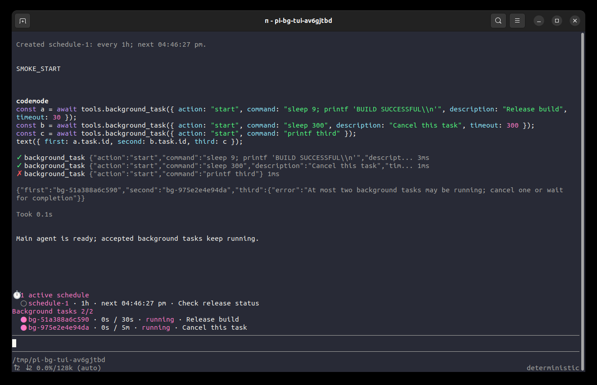
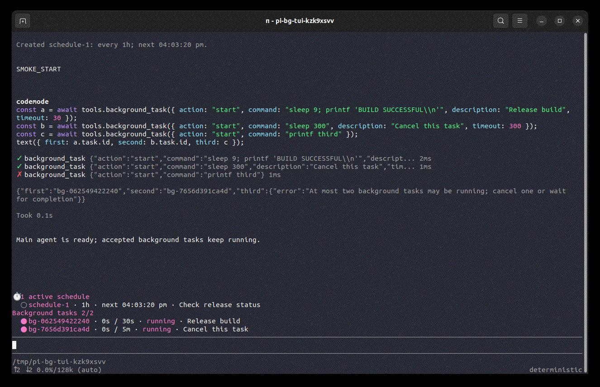

# Pi Background Tasks

Run shell commands in the background, then notify the main agent when they finish. These are local processes, not subagents.





## Why

A command such as `sleep 60; python3 ...` can spend most of its time waiting to check a build log. A normal Bash call keeps waiting for that command. This package returns a task ID immediately so the main agent can do other work.

It uses Pi's public `createLocalBashOperations()` backend for shell execution and process-group cancellation. It adds session ownership, bounded logs, status, and completion messages. It neither replaces Bash nor starts another model or Herdr pane.

Completion delivery follows [oh-my-pi's yield-queue approach](https://github.com/can1357/oh-my-pi/blob/3a2758b68f7c8e6bdf22c3a76b86c8675e5e0c9e/packages/coding-agent/src/session/yield-queue.ts): retain results, combine them at a safe boundary, and filter consumed results before delivery. This package uses Pi's public extension API, not patched host code; a local idle retry covers busy operations that expose no final agent boundary.

## Install and update

Requires Pi **1.3.0 or later**.

```bash
pi install npm:@maxiaochao/pi-background-tasks
pi update npm:@maxiaochao/pi-background-tasks
```

The complete `@maxiaochao/pi-toolkit` package **bundles and enables Background Tasks by default**. Choose either the toolkit or this standalone package; do not install both, because the tool and `/bg` command would be registered twice.

## Agent tool

```text
background_task({ action: "start", command: "sleep 10; printf 'checks complete\\n'", description: "Delayed check", timeout: 120 })
```

Each accepted start includes this exact guidance in the tool's text and `structuredContent.guidance`. The tool description carries it too, including for Codemode discovery:

> 完成会自动通知。现在不要查询等待；继续其他独立工作，没有其他工作就结束当前轮，收到通知后再取结果。

After the completion notification, read the result:

```text
background_task({ action: "output", id: "<returned-task-id>" })
```

The tool also supports listing and cancellation:

```text
background_task({ action: "list" })
background_task({ action: "cancel", id: "<returned-task-id>" })
```

Start returns a running task's ID, log path and runtime limit, not the command's final output. An invalid start is rejected before execution. A later execution error becomes a failed task.

- `command`: unchanged multi-line shell script; only for start.
- `description`: optional display label, shortened to 200 characters.
- `cwd`: optional directory, resolved relative to the current session directory.
- `timeout`: integer seconds, **1800 by default**, from 1 through 7200. Zero and unlimited mode are rejected.
- `id`: required for output and cancel. IDs belong only to their originating session.

At most **two** tasks run at once. A third request fails immediately; it is not queued. Cancelling waits for process cleanup. Cancelling an already-ended task returns its status without another completion notification.

List shows running tasks and the latest 20 finished tasks, with total and omitted counts. Older logs remain queryable by their IDs until the session closes.

## User controls and status

```text
/bg
/bg list
/bg output <returned-task-id>
/bg cancel <returned-task-id>
```

The commands inspect the same jobs without asking a model to perform the operation. Start a command through the agent tool; there is no second shell parser in `/bg`.

A fixed widget **above the editor** shows each task's ID, status, elapsed time, runtime limit and description. It coexists with Scheduler, Todo, and Herdr widgets. Finished rows remain for five seconds; hiding a row does not delete its record. RPC gets a compact active count; non-interactive tools work without the widget.

Completion, failure, cancellation, timeout and output-limit termination update the widget immediately. The extension holds pending completion metadata until it can deliver it safely:

- While the main agent is busy, completions are combined into one message after the current tool batch returns, before the next model request. This includes waiting for a synchronous Herdr subagent; it does not cancel or interrupt that subagent.
- While idle, pending completions are combined on the next event-loop tick and wake the main agent once. Jobs that finish after that batch can produce another notification. Pi's global steering/follow-up queue settings are unchanged.
- If another operation such as manual compaction keeps the session busy without an agent boundary, one local timer retries after 1, 2, 4, 8, 16, then 30 seconds, staying at 30 seconds thereafter. There is no retry-count limit or expiry that discards unread results. This does not call a model or poll shell output.
- Normal tool/settlement boundaries still deliver immediately, without waiting for the retry timer. Without a boundary, an idle session can wait up to the current retry interval (at most 30 seconds, subject to native timer delays). Once a batch is delivered or fully consumed, the next batch starts with an immediate check and fresh backoff.
- A successful tool `output` read of a finished task consumes its pending reminder, including failed tasks. This applies to direct and Codemode callers; a script that reads and filters a result has consumed it even if it does not print it. A running snapshot, `list`, a failed log read, or a user `/bg output` inspection does not consume the main agent's reminder. Consumption does not mean the task passed validation.
- Aborted/error boundaries do not request continuation or replay a previously scheduled wake. An error does not suppress later completions.
- A user interrupt keeps the agent stopped: accepted jobs still run, but even later completions cannot restart it. Unread results remain queryable and are handed to the next user-message run before its first model request. Another extension's custom wake does not release this interrupt state; a new user-message run or session replacement does. This adds no notification pause switch.
- Cancelling manual compaction is separate from interrupting the agent. Pending completions still wake an otherwise-idle session after compaction succeeds, fails or is cancelled.

Pi's public interrupted-run event does not include the abort reason. In particular, starting `/compact` during an active run first interrupts that run. This package preserves that interruption until the next user-message run; it does not infer that compaction grants permission to restart the agent. Compaction started while already idle does not create this interrupted-run state.

Each message includes actual completion times, statuses and log paths, **not the output body**. The agent can call output when it needs details. Completions that arrive near final settlement are checked again before the run settles. No per-task `followUp` messages are left behind the main agent's final report.

Pi reports asynchronous message/run-start failures through its extension error channel. This extension does not automatically replay a message after such a failure; task metadata and captured logs remain queryable for the lifetime of the session.

## Output and safety limits

| View | Limit |
| --- | --- |
| Model-visible output | Last 2000 lines or 50 KiB, whichever is reached first, like Bash |
| Codemode's `structuredContent.output` | Up to 1 MiB of raw log bytes; larger logs keep their first and last 512 KiB with an omission marker |
| Disk capture | 32 MiB per task, 256 MiB total per session |

Display/program-view truncation does **not** stop the command. Disk limits **do** stop the overflowing task with `output_limit`; a full session budget rejects new starts. Nothing silently evicts old logs.

Output includes a log path for further reads. `truncated` describes the program view, not disk capture. `task.capture_complete` is false while running or when log data was lost. The states are `running`, `succeeded`, `failed`, `cancelled`, `timed_out` and `output_limit`.

Output streams to private temporary logs (directory 0700, files 0600 on Unix), with bounded memory and range-limited reads. Log errors stop the task and are reported. Stdout and stderr are merged; strict ordering across the two streams is not promised. Logs and command arguments can contain secrets: choose commands accordingly.

## Codemode and Bash

Use Bash when you need a command's result before proceeding. Codemode composes tool calls and filters their results; it does not itself own background jobs.

Codemode can start a managed job and finish immediately:

```javascript
const started = await tools.background_task({
  action: "start",
  command: "sleep 10; printf 'done\\n'",
  timeout: 120,
});
text(started);
```

This prints the startup guidance as well as the task. Continue independent work or end the turn; do not keep a Codemode worker open to sleep or poll for completion. After notification, another script can read the result. Merely starting an unawaited Bash call is different: Codemode cancels unfinished nested calls when its script ends.

The tool description is compact. This package adds no `promptGuidelines` or extra global system-prompt rules.

## Lifetime and scope

- Exit, new/resumed/forked sessions and reload terminate active tasks, remove the widget and timers, and delete this package's captured logs. Commands' own files are left alone. History is not restored.
- Aborting the main agent's current turn does not cancel an accepted job, but its completion cannot automatically restart the interrupted agent. Use cancel or `/bg cancel` to stop the job itself.
- Cancellation and runtime limits stop the native shell process group. Scripts must wait for their own work. Daemonized/detached commands (`nohup`, `setsid`, self-backgrounding processes), existing PID adoption, PTYs and interactive stdin are not supported.
- This is a distinct **local execution** tool. A third-party sandbox or remote backend installed only for Bash does not automatically cover it. Enable it only where direct local shell execution is permitted.
- It is not an OS sandbox: CPU/memory quotas, cleanup after SIGKILL/power loss, automatic retries, deadline renewal and persistence are out of scope. Native signal delivery and timers are best-effort.
- Pending reminders and notification timers are cleared on session shutdown. Once a completion is delivered into conversation history, reading output does not erase that history. Messages queued by an older installed version cannot be selectively withdrawn by this version.

## Remove

For a standalone installation:

```bash
pi remove npm:@maxiaochao/pi-background-tasks
```

With the toolkit, disable its Background Tasks extension through `pi config` instead of removing a separate package.

For deterministic, real-process, real-TUI and media checks, see [TESTING.md](TESTING.md).
