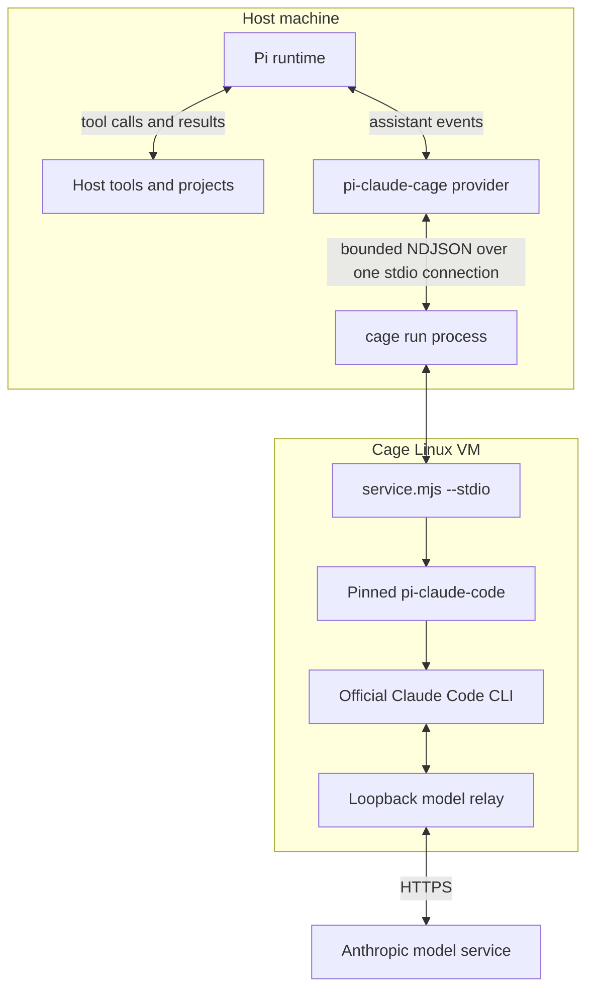

# Pi Claude Cage (experimental)

Use the host's Pi tools and build environment while Claude Code runs in a **running Linux Cage VM**. This optional provider does not replace the `claude-code` provider. The guest uses pinned [pi-claude-code](https://github.com/earendil-works/pi-claude-code/tree/0665b571fe36e4faa894a57c20c2c0be047f3e11) logic for transcript conversion, Claude CLI lifecycle, billing checks, relay validation, response streaming, and the request-wide four-breakpoint cache limit from upstream PR #41.

## Architecture



Each Pi runtime lazily owns one long-lived `cage run` process. A Herdr child is a separate Pi runtime and owns a separate process. Operations are sequential within one runtime. The bridge sends the full transcript first, then sends only an append when history remains a known prefix. The upstream adapter still decides whether Claude Code can continue warmly or needs native transcript replay.

Pi executes tool calls on the host and returns tool results on the next turn. Tool output becomes model input; this package does not sandbox host tools. The bridge opens no LAN listener and needs no shared socket, systemd user service, or bridge-specific environment file.

## Prompt cache retention and warming

Cage republishes prompt-cache metadata only for discovered models that explicitly support adaptive thinking. The pinned adapter writes one-hour cache breakpoints during transcript replay, so Cage advertises only the verified `long: 3600` tier. It does not advertise a five-minute tier: a real Claude Code 2.1.331 acceptance showed that the documented `5m` environment setting did not shorten those explicit one-hour markers.

Set `PI_CACHE_RETENTION=long` before starting Pi to select the verified one-hour tier. With Pi's `cacheWarming: "streaming"` policy, an agent run that remains active long enough, such as during a long host tool call, can receive a hidden refresh near the 54-minute mark. Pi's 30-minute idle safety limit is shorter than that delay, so one-hour Cage metadata does not create an idle warmer. Cage does not implement another scheduler. Any refresh remains a normal Pi `cache_warm` usage entry.

```sh
PI_CACHE_RETENTION=long pi
```

A user turn or Cage control command has priority over warming on Cage's single connection. If one arrives while a low-priority warming request is active, Cage cancels the warmer, waits for its cleanup, and then sends the real operation. It does not replay either request. `cacheRetention: none` asks Claude Code to disable prompt caching and also disables local worker reuse; the pinned adapter remains the owner of replay cache markers.

## Install and configure

Requirements:

- Host Pi 1.6.0 or later.
- Host Node.js 22.19 or later and a POSIX environment with `tar`.
- An initialized, already-running Cage Linux VM.
- Guest Node.js 22.19 or later, npm, Git, and official Claude Code.

Install the standalone package:

```sh
pi install npm:@maxiaochao/pi-claude-cage
```

For local development, run `pi install "$PWD/packages/claude-cage"` from the repository root. Remove a previous local or npm source first so the provider is not loaded twice.

Create `~/.pi/agent/claude-cage.json`, or the equivalent file in your custom Pi agent directory. All paths must be absolute. The first two paths are on the host. `servicePath` is inside the guest.

```json
{
  "executable": "/home/alex/.local/opt/claude-cage-wired/0.2.0-wired.1/cage",
  "config": "/home/alex/.claude-cage-wired/config.json",
  "servicePath": "/home/guest/.local/share/pi-claude-cage/service.mjs"
}
```

Check the expected guest path without making a model request:

```sh
CLAUDE_CAGE_CONFIG=/absolute/path/to/config.json \
  /absolute/path/to/cage run --workdir /tmp -- \
  sh -c 'echo "$HOME/.local/share/pi-claude-cage/service.mjs"'
```

Profiles that still contain `clientPath` are rejected with a migration error. Replace it with `servicePath`, run `/reload`, then run setup.

In Pi:

```text
/reload
/claude-cage-setup
/claude-cage-status
/claude-cage-status models
/model
```

Setup probes the guest and asks for confirmation before it downloads the pinned adapter and installs the stdio service. It does not log in or run a model. A marked v1 installation is stopped and replaced automatically. Unknown, unmarked, foreign, or symlinked destinations fail closed. Fresh v2 setup does not require systemd.

Pi startup does not install files, inspect login, or discover models. `/claude-cage-status` checks the guest CLI and login. `/claude-cage-status models` explicitly requests the catalog and can contact Claude services. Sign in with official Claude Code inside the guest, not with Pi `/login`.

## Runtime and failure behavior

- The fixed maximum model turn is 20 minutes. A caller can request a shorter timeout.
- One logical frame or reconstructed transcript can be at most 256 MiB.
- Writes are sliced and honor stdio backpressure. Thinking output is transferred as deltas rather than repeated cumulative snapshots.
- Clean provider errors, billing rejection, clean cancellation, and confirmed timeout cleanup leave the runtime usable.
- A real model turn, status request, model discovery, or setup operation preempts an active Pi cache-warming turn before it enters the sequential guest request path.
- A malformed protocol, transcript hash mismatch, unexpected process loss, or uncertain outcome closes the connection. Pi shows a red error beginning `Claude Cage connection failed and is closed.` Run `/reload` before using the provider again. The bridge does not reconnect or replay an uncertain request.

The service uses the guest user's Claude login and egress. It does not copy credentials from the host, switch accounts, or select account-specific routes. A disconnected request might already be billed. The bridge does not retry it through another account or provider.

## Update and removal

Update the host package, reload Pi, and deploy the matching guest service:

```sh
pi update npm:@maxiaochao/pi-claude-cage
```

Then run `/reload` and confirmed `/claude-cage-setup` while no Cage turn is active. The host update alone does not modify guest files. Protocol mismatches fail instead of falling back.

The installer pins an exact `pi-claude-code` Git revision. The installed revision is recorded in `~/.local/share/pi-claude-cage/upstream/REVISION` inside the VM. The official Claude Code CLI is separate; this package does not install or update it.

The stdio service exits when its owning Pi runtime closes or reloads. There is no v2 daemon to stop. To remove the guest files, first close all Pi and Herdr runtimes that use the profile, then remove `~/.local/share/pi-claude-cage` inside the VM.

See [guest setup and protocol details](guest/SETUP.md) and [acceptance checks](TESTING.md).


