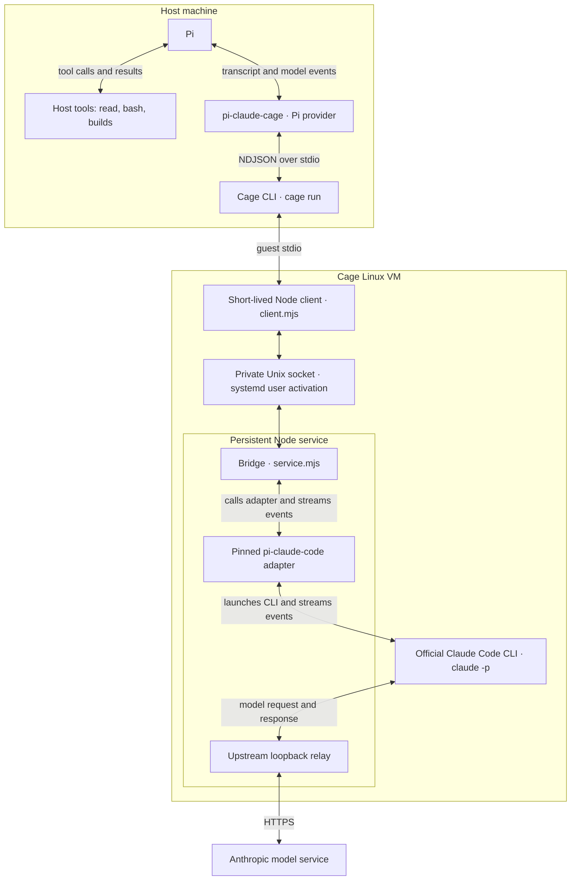
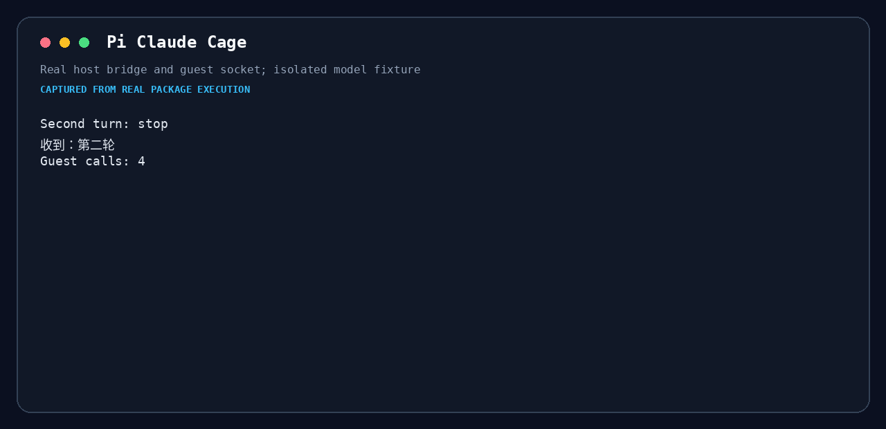

# Pi Claude Cage (experimental)

Use the host's Pi tools and build environment with Claude Code installed in a **running Linux Cage VM**. This optional provider does not replace the `claude-code` provider. No host Claude executable is needed. The guest uses [pi-claude-code](https://github.com/earendil-works/pi-claude-code/tree/d5b5e04c314d3452d357174d16d10dda34daa2d2) for transcript conversion, CLI launch, billing checks and response streaming.

## Where each component runs



The **service** persists across calls. The stdio client is disposable; one call does not hold a Cage terminal open indefinitely. The upstream adapter owns CLI process reuse. Pi executes tool calls on the host and supplies the matching tool results in subsequent turns. Tool outputs become model input; this does not sandbox host tools. No LAN listener or extra project share is needed.

## Install and select the target

Requires host Pi 1.6.0+, Node ≥22.19, a POSIX host with `tar`, and an initialized guest with Node, npm, Git, a working systemd user manager, and official Claude Code. Install the standalone package:

```sh
pi install npm:@maxiaochao/pi-claude-cage
```

For local development, use `pi install "$PWD/packages/claude-cage"` from the repository root instead. If switching to npm, remove the local package source shown by `pi list` first to avoid loading the provider twice.

Create `~/.pi/agent/claude-cage.json` (or use your custom Pi agent directory). Use actual **absolute paths**, not `~`. Example for a Wired installation:

```json
{
  "executable": "/home/alex/.local/opt/claude-cage-wired/0.2.0-wired.1/cage",
  "config": "/home/alex/.claude-cage-wired/config.json",
  "clientPath": "/home/guest/.local/share/pi-claude-cage/client.mjs"
}
```

The first two paths are **on the host**, the last is **inside the guest**. Check the guest path without querying a model:

```sh
CLAUDE_CAGE_CONFIG=/absolute/path/to/config.json /absolute/path/to/cage run --workdir /tmp -- sh -c 'echo "$HOME/.local/share/pi-claude-cage/client.mjs"'
```

In Pi:

```
/reload
/claude-cage-setup
/claude-cage-status
/claude-cage-status models
/model
```

Setup probes the target, then asks before downloading pinned dependencies and enabling the guest socket. Pi startup does not install, discover models or inspect a Claude login. `status` checks the **guest** CLI/login. `status models` explicitly fetches its catalog (can contact Claude services); select `claude-cage` in `/model`. Login is done inside Cage, not with Pi's `/login`.

**Account scope:** the service uses the guest user’s environment-level Claude login and egress. It does not select workbench numbered accounts or configure account-specific network routes. Do not use this mode if you require one of those routes. A response without evidence of a request through the guest relay fails. This is not an account-policy or IP guarantee. A disconnected request might already be billed; the bridge does not retry it or switch to a local provider.

## Use with Herdr Subagents

Child Pi sessions do not load the parent's optional extensions. In `~/.pi/agent/herdr-subagents.json`, or in a project's `.pi/herdr-subagents.json`, add the Cage package to the intended Persona's `extensions` list and set its `model`:

```json
{
  "personas": {
    "reviewer": {
      "model": "claude-cage/default",
      "extensions": ["npm:@maxiaochao/pi-claude-cage"]
    }
  }
}
```

Merge this into existing settings. Keep any other sources that the Persona needs. A Persona's `extensions` list overrides `defaultExtensions`. A task-level `model` can also select a Cage model, but the Persona must still load the provider. Use `/herdr-subagents agents` to inspect the effective configuration before launching a new child. The child uses the existing Cage profile and cached model catalog from its Pi agent directory.

## Update and stop

### Update the host and guest bridge together

Run `pi update npm:@maxiaochao/pi-claude-cage` (or update the local checkout), then `/reload`. When no Cage turns are active, run `/claude-cage-setup` and confirm to deploy the matching guest files. The host update by itself does not change the guest. Protocol mismatches fail rather than falling back to a different provider.

### Update the upstream adapter

[The guest installer](guest/install.sh) pins an exact `pi-claude-code` Git commit. Setup downloads that commit and copies its source into `~/.local/share/pi-claude-cage/upstream/` **inside the VM**. Check `upstream/REVISION` in that directory to see what is installed. This is not a Pi package installation. Updating or removing a host `pi-claude-code` plugin does not affect it.

To ship a newer upstream adapter, a maintainer changes the pin, updates the guest dependency lockfile if needed, and runs the [package acceptance checks](TESTING.md) before releasing `pi-claude-cage`. Users then follow the host and guest update steps above. Rerunning setup on the same package version reinstalls the same pin; it does not fetch upstream `HEAD`.

The **official Claude Code CLI** is a separate guest installation. The bridge does not install, pin, or update that CLI.

### Stop the guest endpoint

Inside the VM, run `systemctl --user disable --now pi-claude-cage.socket`, then `systemctl --user stop pi-claude-cage.service`. Removing the host extension alone does not uninstall guest files. See [guest setup](guest/SETUP.md).




