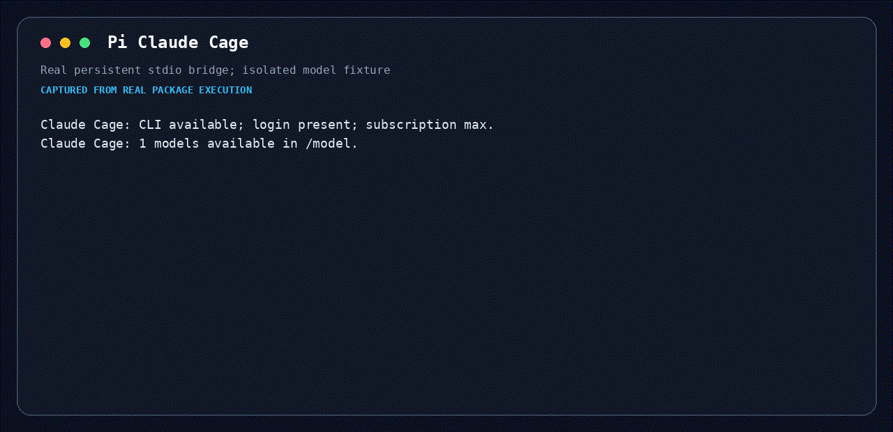

# Pi Claude Cage (experimental)

Use the host's Pi tools and build environment with Claude Code installed in a **running Linux Cage VM**. This optional provider does not replace the `claude-code` provider. No host Claude executable is needed. The guest uses [pi-claude-code](https://github.com/earendil-works/pi-claude-code/tree/d5b5e04c314d3452d357174d16d10dda34daa2d2) for transcript conversion, CLI launch, billing checks and response streaming.

```text
host Pi — cage run (stdio) — guest client — private Unix socket — guest Node service
                                                                      └─ upstream adapter + CLI + relay → Anthropic
```

The **service** persists across calls. The stdio client is disposable; one call does not hold a Cage terminal open indefinitely. The upstream adapter owns CLI process reuse. Pi executes tool calls on the host and supplies the matching tool results in subsequent turns. Tool outputs become model input; this does not sandbox host tools. No LAN listener or extra project share is needed.

## Install and select the target

Requires host Pi 1.6.0+, Node ≥22.19, a POSIX host with `tar`, and an initialized guest with Node, npm, Git, a working systemd user manager, and official Claude Code. From this checkout:

```sh
pi install "$(pwd)/packages/claude-cage"
```

Create `~/.pi/agent/claude-cage.json` (or use your custom Pi agent directory). Use actual **absolute paths**, not `~`. Example for a Wired installation:

```json
{
  "executable": "/home/alex/.local/opt/claude-cage-wired/0.2.0-wired.1/cage",
  "config": "/home/alex/.claude-cage-wired/config.json",
  "clientPath": "/home/guest/.local/share/pi-claude-cage/client.mjs"
}
```

The first two paths are **on the host**, the last is **inside the guest**. Check the guest path without querying a model:

```sh
CLAUDE_CAGE_CONFIG=/absolute/path/to/config.json /absolute/path/to/cage run --workdir /tmp -- sh -c 'echo "$HOME/.local/share/pi-claude-cage/client.mjs"'
```

In Pi:

```
/reload
/claude-cage-setup
/claude-cage-status
/claude-cage-status models
/model
```

Setup probes the target, then asks before downloading pinned dependencies and enabling the guest socket. Pi startup does not install, discover models or inspect a Claude login. `status` checks the **guest** CLI/login. `status models` explicitly fetches its catalog (can contact Claude services); select `claude-cage` in `/model`. Login is done inside Cage, not with Pi's `/login`.

**Account scope:** the service uses the guest user’s environment-level Claude login and egress. It does not select workbench numbered accounts or configure account-specific network routes. Do not use this mode if you require one of those routes. A response without evidence of a request through the guest relay fails. This is not an account-policy or IP guarantee. A disconnected request might already be billed; the bridge does not retry it or switch to a local provider.

## Update and stop

For a local checkout update the code, `/reload`, and rerun `/claude-cage-setup` to deploy the matching guest revision. Do not update the installed guest source separately. Protocol mismatches fail. Active guest turns can be interrupted by an upgrade. To stop the guest endpoint, run `systemctl --user disable --now pi-claude-cage.socket` then `systemctl --user stop pi-claude-cage.service` **inside the VM**. Removing the host extension alone does not uninstall guest files. See [guest setup](guest/SETUP.md) and [verification](TESTING.md).



