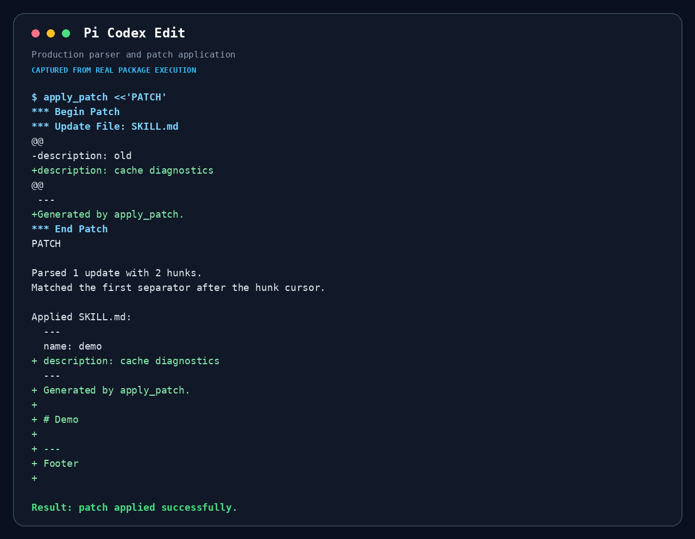
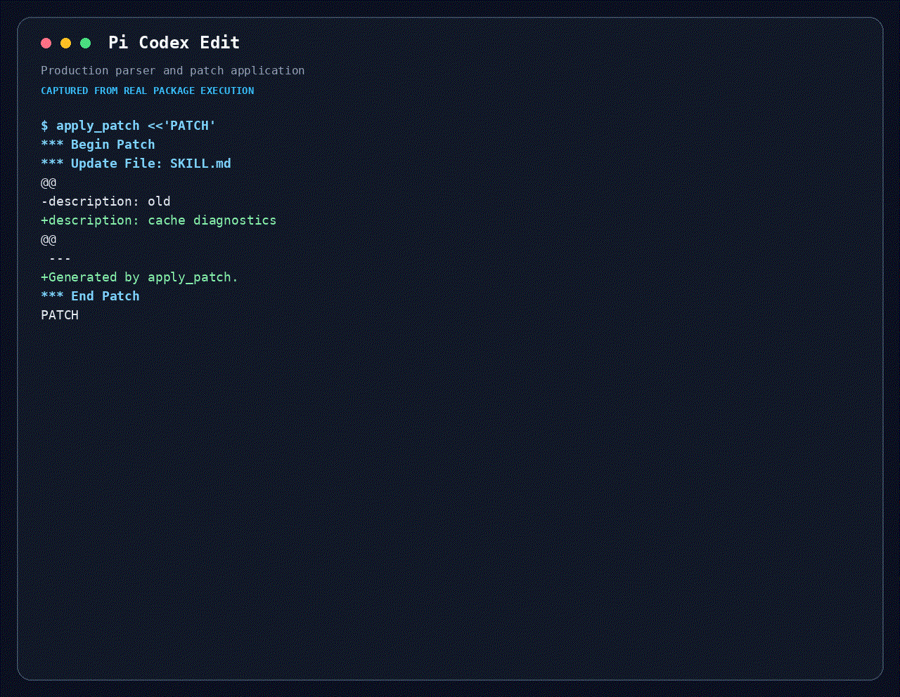

# Codex Edit (apply_patch)

A Pi extension that gives selected GPT models the same `apply_patch` editing protocol used by the Codex harness, while every model outside the routing rules keeps Pi's native `edit` tool.



## Why this package exists

GPT models used through the Codex harness are trained to edit with OpenAI's `apply_patch` protocol, while Pi's native editor uses a different `oldText/newText` contract. This package exposes the Codex-harness editing interface inside Pi for explicitly allowed models. Models that do not match the rules continue to see Pi's native `edit`; the extension never replaces the editor universally.

The implementation follows Codex's ordered hunk matching semantics and supports the same Add/Delete/Update/Move patch shape, then adds workspace, symlink, overwrite, preflight, and mutation-queue safeguards required by Pi.

## Demo



```text
*** Begin Patch
*** Update File: src/app.ts
@@
-const enabled = false;
+const enabled = true;
*** End Patch
```

The complete patch is parsed and preflighted before any file is mutated; the result reports per-file diffs and committed paths.

## Install

Install it as a separate package:

```bash
pi install npm:@maxiaochao/pi-codex-edit
```

This is the standalone child package of `@maxiaochao/pi-toolkit`. The full toolkit already bundles the same implementation, so install this package only when you do not want the rest of the toolkit. Installing both is unnecessary and may register `apply_patch` twice.

Update whichever distribution you installed:

```bash
pi update npm:@maxiaochao/pi-toolkit     # full toolkit, including bundled Codex Edit
pi update npm:@maxiaochao/pi-codex-edit  # standalone child package
```

The two npm packages have independent versions. An implementation or configuration change reaches toolkit users only after a new `@maxiaochao/pi-toolkit` version is published, and reaches standalone users only after a new `@maxiaochao/pi-codex-edit` version is published.

The extension registers `apply_patch` and selects the editing tool from the resolved model configuration:

- Allowed model ID on a supported Responses API: Codex-harness-compatible `apply_patch`
- Model ID outside the allowlist: Pi's native `edit`
- Model on another API, even if its ID matches: Pi's native `edit`

The default allowlist enables all `gpt-5.6-*` models regardless of provider. Other model families can be added after separate validation in `~/.pi/agent/codex-edit.json`.

The extension does not add a permanent AGENTS rule telling models not to use `apply_patch`. Only the selected editor tool is active, so the model receives one editing protocol.

## What `apply_patch` does

The tool accepts raw Codex patch text between `*** Begin Patch` and `*** End Patch`. It supports:

- `Add File`
- `Delete File`
- `Update File`
- `Move to`
- multiple update hunks with `@@` context
- repeated `Update File` blocks for the same path, applied in patch order
- EOF-oriented insertions

Before writing, it parses the complete patch, resolves paths, rejects workspace escapes and unsafe symlink/parent paths, reads all source files, and computes every update in memory. Only after preflight succeeds does it mutate files. It returns per-file diff details and reports committed paths if a later filesystem operation fails.

Repeated plain updates to one file are coalesced into one file operation and each block sees the result of the previous block. Conflicting reuse of a path by add/delete/move operations is still rejected. Empty update chunks, missing `patch` arguments, and stale expected lines fail without guessing or partially applying the patch.

This repeated-header tolerance is a deliberate Pi-side extension: current Codex verified invocation rejects multiple operations resolving to one path and expects multiple `@@` chunks under one `Update File` header. Codex Edit accepts repeated headers only when they are plain updates to the exact same raw path, because this malformed-but-unambiguous shape has occurred in real model output. Resolved aliases such as `src/a.ts` and `src/./a.ts`, moves, adds, and deletes remain conflicting.

## Configuration

The extension reads package defaults from its bundled `config.json`, then applies user overrides from `~/.pi/agent/codex-edit.json`. The user file is outside the installed package, so package updates do not replace your rules. When `PI_CODING_AGENT_DIR` is set, the user file is `<PI_CODING_AGENT_DIR>/codex-edit.json` instead.

Each user field overrides the corresponding package default. `models` replaces the entire default list, rather than appending; `[]` clears it. Omitted fields inherit defaults. A missing user file is allowed. Invalid JSON, invalid known field types, or unreadable files fail extension loading with the file path instead of silently ignoring your rules. Unknown fields are ignored. There is no project-level Codex Edit configuration.

The package default model-ID allowlist is `"gpt-5.6-*"`. Provider does not affect routing. Each entry is a `*` glob, so this matches every `gpt-5.6-` variant. The route additionally requires:

```text
model.api = openai-responses or openai-codex-responses
```

The effective routing rule is:

```text
settings.enabled
and model.api in ["openai-responses", "openai-codex-responses"]
and model.id matches at least one settings.models pattern
```

Patterns are case-sensitive, match the complete model ID, and support `*` as the wildcard. Provider name is intentionally ignored.

### Add model rules

Create `~/.pi/agent/codex-edit.json` and add validated model-ID patterns:

```json
{
  "enabled": true,
  "models": [
    "gpt-5.6-*",
    "gpt-5.7-*",
    "my-codex-model"
  ]
}
```

Examples:

| Pattern | Matches | Does not match |
|---|---|---|
| `gpt-5.6-*` | `gpt-5.6-sol`, `gpt-5.6-terra` | `gpt-5.7-sol` |
| `gpt-*-codex` | `gpt-5.6-codex` | `gpt-5.6-codex-mini` |
| `my-codex-model` | exactly `my-codex-model` | `my-codex-model-v2` |

Adding a pattern only changes routing; it does not prove that a model handles the Codex protocol correctly. Validate the model before adding it to the default allowlist. A matching model on `anthropic-messages`, `openai-completions`, or another unsupported API still uses Pi's native `edit`.

Grammar support is not part of the route. When a provider does not emit Lark grammar tools, Pi falls back to a normal function tool, so `apply_patch` still runs there — only the grammar-enforced output shape is lost.

Use a boolean for `enabled` and an array of non-empty strings for `models`. Set `"enabled": false` in the user file to disable all `apply_patch` routing. Do not edit the installed package's `config.json` for personal rules; move any existing personal rules into the user file.

Configuration is read when the extension loads. After changing it, use `/reload` or restart Pi. Already running subagents retain their loaded configuration; start a new child to read changes. Parent sessions and subagents that load Codex Edit use the same user file when they share the same agent directory, regardless of working directory or toolkit/standalone distribution. The implementation keeps both tools registered for session replay and changes only the active tool set on `session_start` and `model_select`.

Herdr Subagents does not automatically inherit the parent's extensions. To enable Codex Edit for a writing Persona, include the installed Codex Edit extension file in that Persona's `extensions` array in `~/.pi/agent/herdr-subagents.json`. You may instead use top-level `defaultExtensions` when the Persona has no explicit extension list; Persona-specific lists replace defaults, not merge with them. Preserve any authentication-provider extensions already configured. Read-only Personas should not gain editing tools.

## Documentation

- `summary.md`: historical 20-case benchmark and decision record.
- `codex-edit-explainer.html`: self-contained interactive architecture and configuration explainer.
- `TESTING.md`: deterministic test flow, mandatory native-vs-Codex and released-vs-local comparisons, growing regression corpus, and latest baseline.
- `docs/test-summary.md`: current short test summary.
- `docs/test-report.html`: current self-contained report; its authoritative source is `docs/test-report.md`.

The historical 20-case benchmark found equal final correctness, with first editor-call success improving from 85% to 95%. The completed frozen 100-task three-arm benchmark (`explicit-edit-100-sol-low-v3-complete`) ran all 300 chains: native and released v0.1.7 scored 91.25%, while the local version scored 92.00%. All arms reached 92% Final Exact, all eight final failures were shared, and there was no local-only final regression. The sanitized run evidence is committed under `benchmark/results/`; the generated report contains the full methodology, paired results, efficiency, and safety evidence.

## Filesystem safety

Preflight rejects file/parent target conflicts before any write. Move preserves ordinary permission bits, including executable bits. These checks prevent predictable path conflicts; they do not promise cross-file rollback for arbitrary disk failures. Real-filesystem regressions cover both operation orders, unchanged original bytes after rejection, and moved-file permissions.
