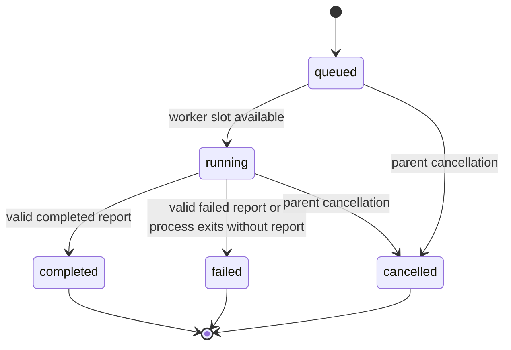
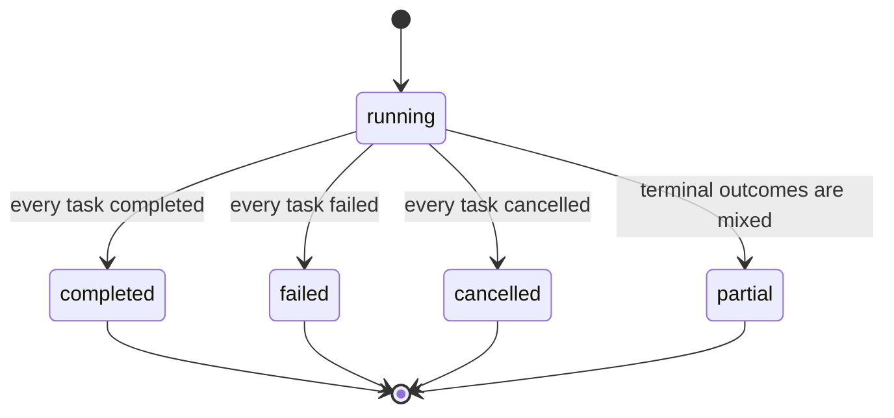
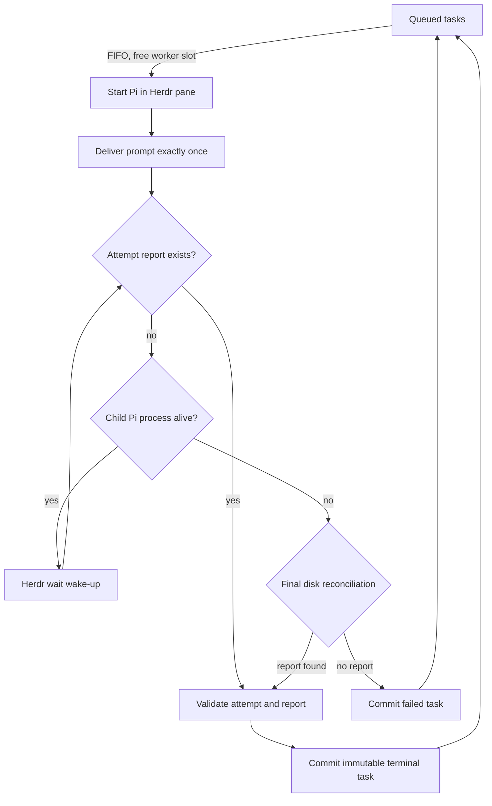

# Herdr Subagents architecture

## Goal

Herdr owns terminal presentation and pane operations. The package owns scheduling and durable state. Pi children own only their attempt result.

The implementation deliberately stays small: one task state machine, one run aggregation rule, and one bounded worker pool. Serial and read-only parallel dispatch share the same path. There are no alternate lifecycle engines for background work, blocking, retries, or resume.

## State machines

Task:

The three terminal states are immutable. Follow-up work creates a new task or run.

Run:

Run state is derived from task state. `partial` means terminal tasks have mixed outcomes.

Scheduler and arbitration:

Herdr `idle`, `blocked`, and `done` never transition a business task; they only wake the reconciliation loop.

Legacy readers still accept old `starting` and `blocked` values so existing archives can be inspected and cleaned up. New execution does not produce them.

## Scheduling

A run uses a bounded worker pool:

1. Tasks begin FIFO.
2. With concurrency one, the next task cannot start until the previous task is terminal.
3. With concurrency N, at most N tasks own live child processes.
4. Failure consumes only that task's lane; queued siblings continue.
5. Parallel execution is rejected if any task is write-capable.
6. The caller remains attached until all tasks are terminal or the caller cancels.

There is no global dispatcher, persisted background queue, blocked response lane, historical resume, or early detach.

## Child boundary

Each task owns one Herdr pane and one single-task Pi process. Herdr first starts and detects the interactive Pi, then submits the prompt exactly once. At Pi’s final `agent_settled` boundary, the child extension records settled state but leaves the interactive process alive. The atomic report remains the authoritative task result. Early-finishing children remain visible while sibling tasks continue. Once the whole run settles, the orchestrator closes an unfocused owned tab immediately and defers a focused tab until the user leaves it, so Pi can restore the terminal normally.

The child writes:

- `results/<attempt-id>.md`
- `reports/<attempt-id>.json`

Both are attempt-scoped. The report is published with atomic rename. The orchestrator validates it, verifies the attempt identity, and promotes it to `report.json`.

The orchestrator writes:

- `task.json`
- `run.json`
- promoted `report.json`

## Completion arbitration

1. Check for a valid attempt report.
2. If present, the report wins, including against a concurrent cancellation observation.
3. Otherwise inspect child process liveness.
4. While the process is alive, keep waiting. Herdr agent states only wake reconciliation.
5. If the process has exited, check disk once more and fail only when no report exists.

There is no fixed drain delay and no transcript parsing. Pi retries are internal to the same one-shot process, so transient provider or transport errors cannot create a premature terminal task.

Writing the same report again is idempotent. A conflicting replacement is rejected.

## Cancellation and shutdown

Caller or parent-session cancellation aborts active waits, marks nonterminal tasks cancelled, and closes the Herdr tab owned by that session. A new Pi session never scans, mutates, resumes, or closes historical runs during startup. If Pi is terminated before its shutdown handlers run, its visible Subagent tabs remain for explicit user inspection or cleanup.

## Tool exposure

The extension reads optional `exposure` once before registering its two tools. When omitted, the extension also omits the registration field and delegates to Pi's default. Global or project configuration can select Pi's `model-only` or `direct` exposure explicitly. Changing this registration-time setting requires `/reload` or a Pi restart; the extension does not re-register tools during a session.
