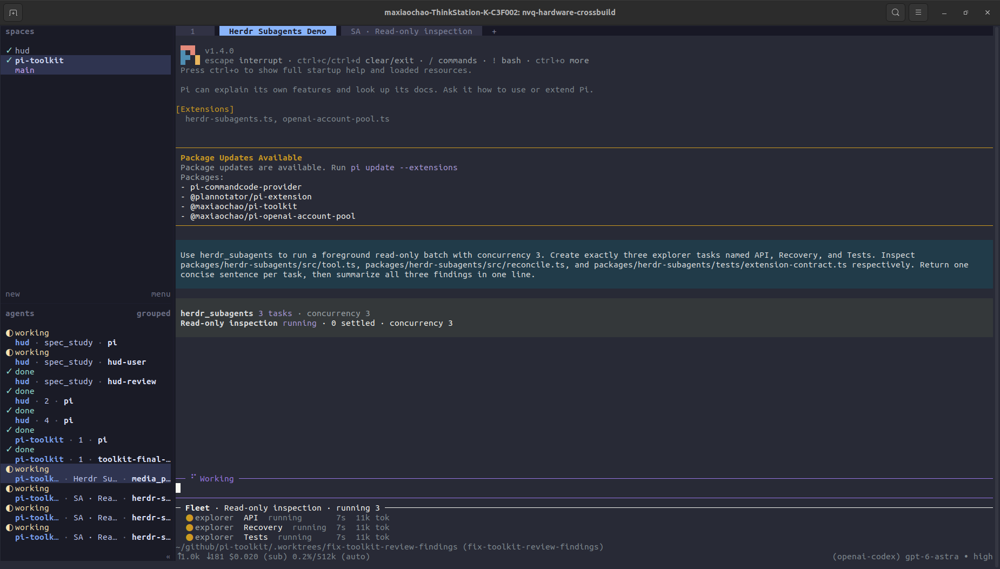

# Herdr Subagents

Run focused Pi subagents in visible, focusable Herdr panes and collect exactly one terminal result per task.

The implementation is intentionally small: one task state machine, one derived run state, and one bounded worker pool. Herdr provides visible panes and navigation; the package only dispatches serial or read-only parallel work, waits for a report, and records the result. It does not add a second workflow engine around Pi.



## Demo

https://github.com/user-attachments/assets/8ddf3ae6-a11a-492b-9cae-d9496ba65b67

The reproducible source recording is retained as [`docs/demo.webm`](docs/demo.webm).

## Requirements and install

Run Pi inside a Herdr workspace, then install the standalone package:

```bash
pi install npm:@maxiaochao/pi-herdr-subagents
```

Update it with `pi update npm:@maxiaochao/pi-herdr-subagents`. The full `@maxiaochao/pi-toolkit` package already bundles this extension, so install the toolkit or this standalone package, not both.

The tools and command are registered only when Pi is running inside Herdr with a workspace ID. If they are unavailable after entering Herdr, use `/reload` or restart Pi there.

## Execution contract

`herdr_subagents` accepts an ordered, non-empty `tasks` array. Every task must explicitly set `agent`; there is no default Persona.

- `concurrency: 1` runs tasks strictly in input order.
- `concurrency: N` runs at most N read-only tasks at once.
- A run containing a write-capable persona must use `concurrency: 1`; unsafe parallel writes are rejected.
- One task failing does not cancel its siblings.
- The tool returns only after every task is `completed`, `failed`, or `cancelled`.
- There is no background queue, blocked/respond flow, automatic resume, or early failure detach.

```json
{
  "label": "review",
  "concurrency": 2,
  "tasks": [
    { "name": "api", "prompt": "Review the API boundary.", "agent": "reviewer" },
    { "name": "tests", "prompt": "Find missing test coverage.", "agent": "explorer" }
  ]
}
```

Each task starts a single-task interactive Pi process in its own Herdr pane. Herdr first confirms the interactive Pi is ready, then the prompt is delivered exactly once. Prompt acknowledgement never decides task completion. Panes remain ordinary Herdr panes: they can be focused and inspected while work is running or after it settles. An early-finishing child stays at the Pi UI while sibling tasks continue. After the whole run settles, cleanup closes an unfocused run tab immediately or waits for the user to leave a focused run tab.

Cleanup belongs to the Pi session that created the run. Starting a new Pi session never scans historical runs or closes their recorded Herdr tabs. If Pi terminates before shutdown cleanup runs, any surviving Subagent tab remains visible for explicit inspection or cleanup.

## Result protocol

When the task finishes or cannot be completed, the child must call `subagent_report` once instead of ending with a normal text reply. The terminal status is:

- `completed`: the requested work finished.
- `failed`: it cannot be completed; include `error`.

The complete result is stored on disk. The parent receives only the compact summary and document paths.

The child UI renders only the report status and saved size instead of echoing the complete result argument. The parent-facing tool result includes one complete-result path per task; additional consulted-document metadata remains in the durable report.

An atomically renamed attempt report is the authoritative completion signal. Herdr states such as `idle`, `blocked`, and `done` are wake-up hints only. A prompt transport error or Pi retry cannot fail a task while its child process remains alive. If the process exits without a valid report, the task fails explicitly.

Duplicate identical reports are idempotent. A conflicting report for the same task attempt is rejected. Terminal task records are immutable.

## State model

The same small state machine is used for every task; there are no separate foreground, background, blocked, resumed, or retry lifecycles.

New task records use:

```
queued -> running -> completed | failed | cancelled
```

A run is `running` while any task is queued or running. Settled aggregate states are `completed`, `failed`, `partial`, or `cancelled`.

Older records containing `starting` or `blocked` remain readable for history and cleanup, but new runs never write those states.

## Durable records

Records are stored under:

```
.pi/herdr-subagents/runs/<sortable-run-id>/
  run.json
  tasks/<order>-<task-id>/
    task.json
    session.jsonl
    system-prompt.md
    report.json
    reports/<attempt-id>.json
    results/<attempt-id>.md
```

The orchestrator is the only writer of `run.json`, `task.json`, and promoted `report.json`. The child only writes its attempt-scoped result and report.

## Tools and UI

### `herdr_subagents`

Starts one ordered batch and waits until every task reaches a terminal state. Its parameters are:

| Field | Required | Default | Purpose |
| --- | --- | --- | --- |
| `tasks` | Yes | — | Non-empty ordered task array. |
| `label` | No | `"batch"` | Short Herdr run-tab label, at most 48 characters. |
| `concurrency` | No | `defaultConcurrency` | Maximum number of simultaneously active read-only tasks. It is capped by `maxConcurrency`. |
| `tasks[].name` | Yes | — | Short pane/task name, at most 48 characters. |
| `tasks[].prompt` | Yes | — | Self-contained task instructions. |
| `tasks[].agent` | Yes | — | Effective Persona name; use control `list` to inspect available Personas. |
| `tasks[].model` | No | Persona/default model | Model override for this task. |

A batch containing a write-capable Persona must explicitly or effectively use `concurrency: 1`; an unsafe parallel request is rejected.

### `herdr_subagents_control`

| Action | `runId` | Purpose |
| --- | --- | --- |
| `list` | Not accepted | List effective Personas, resolved options, and diagnostics. |
| `status` | Required | Show one run and its task states. |
| `history` | Not accepted | List durable project-local run history. |
| `cancel` | Required | Cancel an active run. |
| `cleanup` | Required | Remove one archived run. |

Settled tasks are immutable. Follow-up work starts a new task or run; there is no resume/respond lifecycle.

### Slash command

`/herdr-subagents` supports:

| Command | Purpose |
| --- | --- |
| `active` | Show the current run. This is also the default with no argument. |
| `history` | Show project-local history. |
| `focus <task-number>` | Focus a running task pane. |
| `agents` | Show effective Persona source, access, model, thinking, tools, skills, and extensions. |
| `models` | List authenticated Pi models. |
| `settings` | Show effective settings, their sources, and configuration diagnostics. |

## Configuration and Personas

Settings and Persona definitions are separate:

| Scope | Settings file | Persona directory |
| --- | --- | --- |
| Project | `<project>/.pi/herdr-subagents.json` | `<project>/.pi/herdr-subagents/agents/*.md` |
| Global | `~/.pi/agent/herdr-subagents.json` | `~/.pi/agent/herdr-subagents/agents/*.md` |
| Package | Built-in defaults | Installed package `agents/*.md` |

For JSON settings, project fields override global fields, which override built-in defaults. `personas` entries merge by Persona name and then by field; array values replace lower-precedence arrays rather than appending to them.

Persona Markdown uses whole-definition replacement instead of field merging. A same-name definition is selected in this order:

1. project Persona
2. global Persona
3. package Persona

### Complete settings reference

These are all supported top-level fields in `herdr-subagents.json`:

| Option | Accepted value | Built-in default | Purpose |
| --- | --- | --- | --- |
| `exposure` | `"model-only"` or `"direct"` | Unset (inherit Pi; currently `direct`) | Controls whether the two tools may be called only by the top-level model or also by nested tools such as Codemode. |
| `defaultConcurrency` | Positive integer | `1` | Concurrency used when a call omits `concurrency`; capped to `maxConcurrency`. |
| `maxConcurrency` | Positive integer | `4` | Hard ceiling for requested/default read-only concurrency. It does not make write-capable batches safe. |
| `stalledWarningSeconds` | Positive integer | `300` | Emit a warning after a child runs this long. This is not a timeout and does not stop it. |
| `defaultModel` | Non-empty Pi model ID, normally `provider/model` | Unset | Fallback child model. If unset, the parent model is inherited. |
| `defaultThinking` | Non-empty Pi thinking value | Unset | Fallback thinking level below Persona-specific settings. Typical Pi values are `off`, `minimal`, `low`, `medium`, `high`, `xhigh`, and `max`; model support varies. |
| `defaultExtensions` | Array of non-empty Pi source strings | Unset (no optional extensions) | Fallback extension sources for Personas without an explicit `extensions` list. Project replaces global; `[]` clears inherited defaults. |
| `personas` | Object keyed by an existing Persona name | `{}` | Per-Persona overrides. It cannot create a Persona without a matching Markdown definition. |

Each `personas.<name>` object supports:

| Option | Accepted value | Purpose |
| --- | --- | --- |
| `model` | Non-empty Pi model ID | Override the model from Persona Markdown and `defaultModel`. |
| `thinking` | Non-empty Pi thinking value | Override Persona Markdown and `defaultThinking`. |
| `skills` | Array of non-empty strings | Replace the lower-precedence explicit skill list. Use `[]` to clear it. |
| `extensions` | Array of non-empty Pi source strings | Replace the lower-precedence extension-source list. Use `[]` to clear it. |

JSON overrides cannot change a Persona's `name`, `description`, `access`, `tools`, or system prompt; those belong in its Markdown definition.

Invalid known values are ignored and reported by `/herdr-subagents settings` or the control tool's `list` action. If `defaultConcurrency` exceeds `maxConcurrency`, the effective default is reduced to the maximum. Model IDs, thinking compatibility, skills, and extension sources are ultimately resolved by child Pi.

### Exposure

Use the restrictive mode when only direct model calls should be allowed:

```json
{
  "exposure": "model-only"
}
```

- `model-only`: the top-level model may call the tools, but Codemode scripts and other tools cannot invoke them as nested tools.
- `direct`: allow both top-level and nested calls explicitly.
- omitted: do not set an exposure during registration; inherit Pi's default behavior.

`exposure` is read once when the extension registers. After changing it, use `/reload` or restart Pi. Other settings and Persona files are re-read at the start of each new tool call; they do not modify an already running task.

### Complete global example

Save this as `~/.pi/agent/herdr-subagents.json`. Model IDs, skills, and extension sources are illustrative and must exist in your Pi environment.

```json
{
  "exposure": "model-only",
  "defaultConcurrency": 2,
  "maxConcurrency": 4,
  "stalledWarningSeconds": 300,
  "defaultModel": "anthropic/claude-sonnet-4-5",
  "defaultThinking": "medium",
  "defaultExtensions": ["~/.pi/agent/extensions/provider-routing.ts"],
  "personas": {
    "explorer": {
      "model": "anthropic/claude-haiku-4-5",
      "thinking": "low",
      "skills": ["code-search"]
    },
    "reviewer": {
      "thinking": "high",
      "skills": ["code-review"],
      "extensions": []
    }
  }
}
```

A project can override only what differs in `.pi/herdr-subagents.json`:

```json
{
  "defaultConcurrency": 3,
  "stalledWarningSeconds": 600,
  "personas": {
    "explorer": {
      "model": "openai/gpt-5.2",
      "skills": []
    },
    "reviewer": {
      "extensions": ["npm:@example/pi-review-tools@1.0.0"]
    }
  }
}
```

Here the project keeps global `maxConcurrency`, `defaultModel`, `defaultThinking`, and `defaultExtensions`; replaces the explorer model and skill list; and replaces the reviewer extension list. It does not append arrays.

### Built-in Personas

None of the bundled Personas pins a model, thinking level, skill, or optional extension. Those values come from configuration or parent-session inheritance.

| Persona | Access | Built-in tools | Intended use |
| --- | --- | --- | --- |
| `worker` | `write` | `read`, `bash`, `edit`, `write`, `grep`, `find`, `ls`, `codemode` | One focused implementation or other file-changing task. |
| `explorer` | `read` | `read`, `bash`, `grep`, `find`, `ls`, `codemode` | Codebase structure, behavior, and dependency investigation without file changes. |
| `analyst` | `read` | `read`, `bash`, `grep`, `find`, `ls`, `codemode` | Neutral agent-team execution where each task supplies the role charter and evaluation method. |
| `reviewer` | `read` | `read`, `bash`, `grep`, `find`, `ls`, `codemode` | Independent review of proposals, designs, documents, implementations, and analysis against goals and constraints. |

Choose `reviewer` for an independent assessment of existing work, `explorer` to investigate how the codebase works, `worker` for file-changing work, and `analyst` for agent-team members whose role is supplied by the task charter. An analyst may perform a review when its charter calls for one; its neutral execution role does not replace the reviewer selection for ordinary review requests.

The control tool's `list` action exposes each effective `description` to help the parent choose a Persona. The Markdown body instead becomes the selected child's appended system prompt. Put selection guidance in `description` and execution instructions in the body; bundled definitions keep both in English.

`access` is a scheduling declaration: any `write` Persona requires serial execution. It is not by itself a sandbox. For a custom read-only Persona, also omit write-capable tools and load only trusted extensions.

### Custom Persona example

Save the following as `.pi/herdr-subagents/agents/security-reviewer.md` (or in the global Persona directory):

```md
---
name: security-reviewer
description: Read-only reviewer for security risks
access: read
model: anthropic/claude-sonnet-4-5
thinking: high
tools: read, bash, grep, find, ls, codemode
skills: security-review, code-review
extensions: ~/.pi/agent/extensions/provider-routing.ts
---

Review the assigned scope without modifying files. Separate confirmed vulnerabilities from hypotheses and cite concrete evidence.
```

The Markdown body is the child system prompt. Frontmatter is intentionally a small single-line format, not full YAML:

| Field | Accepted value | Required/default | Purpose |
| --- | --- | --- | --- |
| `name` | Non-empty string | Required | Identifier used by `tasks[].agent`; unique within one directory. |
| `description` | Non-empty string | Required | Description shown by Persona listings. |
| `access` | `read` or `write` | `write` | Scheduling safety declaration. |
| `model` | Non-empty Pi model ID | Unset | Persona model default. |
| `thinking` | Non-empty Pi thinking value | Unset | Persona thinking default. |
| `tools` | Non-empty comma-separated list, optionally `[bracketed]` | Pi child defaults | Built-in-tool allowlist. Supported names: `read`, `bash`, `edit`, `write`, `grep`, `find`, `ls`, `powershell`, `codemode`. `subagent_report` is always added. |
| `skills` | Comma-separated list, optionally `[bracketed]` | None | Explicit child skills; normal automatic skill discovery is disabled. |
| `extensions` | One source or a comma-separated list; `[]` clears | None | Additional Pi extension/package sources loaded into the child. |

### Explicit extension sources and Pi packages

Use top-level `defaultExtensions` in `~/.pi/agent/herdr-subagents.json` to share trusted extension sources across Personas. Set the same field in `<project>/.pi/herdr-subagents.json` to replace the global default list for that project. Defaults are a fallback, not an appended list: any Persona-specific `extensions`, including Markdown frontmatter and explicit `[]`, takes precedence. An empty default list clears inherited defaults but does not remove Persona-specific sources or the mandatory child extensions.

Relative extension paths resolve from the project root, including paths in global `defaultExtensions`. `~` resolves to the home directory. Pi-native local, `npm:`, `git:`, and `builtin:` sources are accepted. Children always load the required report extension and Codemode; configured sources are additional. Pi packages may provide resources beyond extensions, so load only trusted code and pin versions/refs when reproducibility matters.

### Effective option precedence

The child model is selected in this order:

1. `tasks[].model`
2. project `personas.<name>.model`
3. global `personas.<name>.model`
4. effective Persona Markdown `model`
5. effective `defaultModel` (project, then global)
6. parent Pi model

Thinking is selected in this order:

1. project `personas.<name>.thinking`
2. global `personas.<name>.thinking`
3. effective Persona Markdown `thinking`
4. effective `defaultThinking` (project, then global)
5. parent thinking when the child also inherits the parent model

There is no task-level thinking override. `skills` uses project Persona JSON, then global Persona JSON, then effective Persona Markdown.

Extension sources are selected in this order:

1. project `personas.<name>.extensions`
2. global `personas.<name>.extensions`
3. effective Persona Markdown `extensions`
4. project `defaultExtensions`
5. global `defaultExtensions`
6. no optional extensions

Each winning list replaces the whole lower-precedence list, including when it is `[]`. The required report extension and Codemode always remain loaded. `/herdr-subagents settings` shows the effective defaults and their source; the agents listing shows each resolved extension list and its source.

Use `/herdr-subagents agents`, `/herdr-subagents models`, and `/herdr-subagents settings` to inspect the result before starting work.

## Development and tests

See [TESTING.md](TESTING.md) for deterministic tests, extension loading, packaging, and real Herdr smoke requirements. The real smoke preserves your configured `analyst` model, thinking level, and explicit extensions (including authentication providers) inside its isolated fixture; unrelated Persona settings remain isolated.
