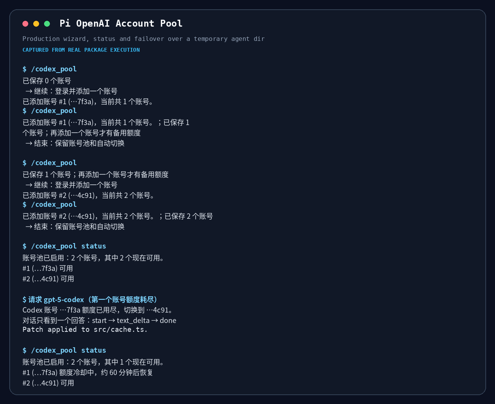
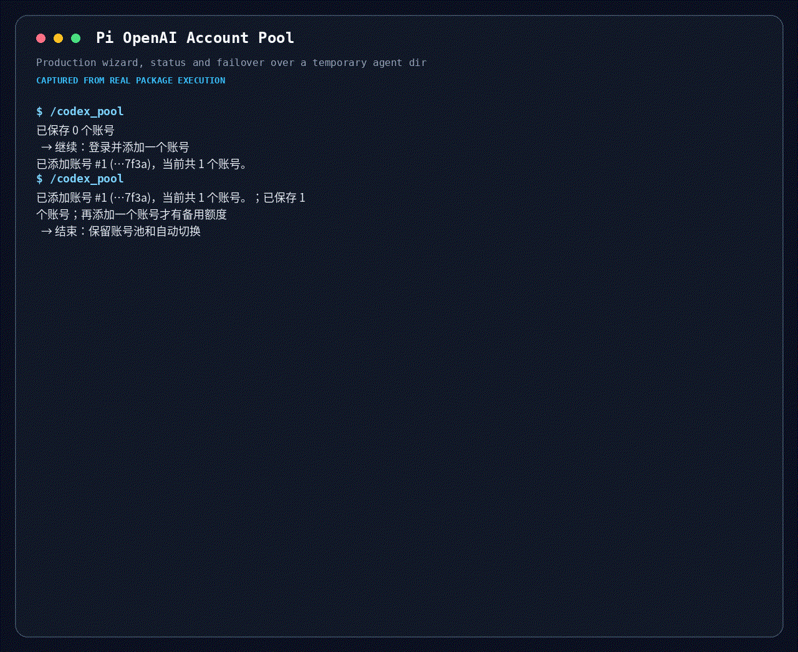

# Pi OpenAI Account Pool

Pool several ChatGPT Plus/Pro logins behind pi's built-in `openai-codex` provider. When the account in use proves it is out of subscription quota, the same request continues on another account — same conversation, same model, same thinking level, no replayed tools.





## Why

`/login openai-codex` stores one credential per provider: logging in a second account overwrites the first. Hitting the subscription limit therefore means logging in again by hand, in the middle of the work. This package keeps every authorized account side by side and picks the next usable one for you.

It does not create accounts, share them between people, or work around a limit on one account. It only uses logins you authorized yourself, one at a time.

## Install

```bash
pi install npm:@maxiaochao/pi-openai-account-pool
```

Update it with `pi update npm:@maxiaochao/pi-openai-account-pool`. Installing alone changes nothing: the pool turns on the first time you add an account.

`pi install npm:@maxiaochao/pi-toolkit` does not enable this package, so the two installs may be combined. Toolkit 0.11.9 and earlier embedded it: do not add this package next to one of those versions, because `/codex_pool` would register twice.

## User command

```text
/codex_pool                 添加账号：反复确认「继续 / 删除 / 结束」，继续一次就登录一个账号
/codex_pool status          输入框上方立即显示彩色临时面板并在后台查询官网 5 小时/周额度；标出 ★首选 与 ●本会话
/codex_pool use             下拉选择首选账号（`use auto` 恢复按编号确定优先级）
/codex_pool remove          下拉选择要删除的账号（也可写 `remove 2` 或 `remove 邮箱`）
/codex_pool off             恢复原生单账号登录
```

`/codex_pool` 先显示确认界面，不会无提示打开浏览器。选择继续就走一次原生 Codex 登录；成功后立即原子保存，并回到同一个界面，可以一直加下去。结束只结束添加，账号池和自动切换保留；Esc 取消的是当前这次授权。

账号按登录邮箱显示（如 `#2 (you@example.com)`），包括删除与首选账号列表。邮箱取自访问令牌的 profile 或顶层 email 声明，已有账号也会在读取时补全；两处都没有有效邮箱时回落到脱敏标识。去重按 ChatGPT 账号 id：重新登录同一个账号只更新它的凭据和标签，编号和总数不变，这也是授权失效后重新授权的做法。

第一次成功添加会把原有的 `openai-codex` 登录一起并入池，不会丢失。

`remove` 每次只删除选中的一个账号，同时更新 `auth.json` 中的账号池引用并删除该账号的凭据。还有其他账号凭据时保留主 `openai-codex` 引用；删除最后一个实际账号时，也会清理凭据已被其他退出操作删除的残留引用，一并删除主引用，恢复为未登录。取消选择或确认不会修改配置。

启动时也会检查残留引用：只清理指向缺失凭据的账号，并显示清理提示；没有实际账号后删除主引用。过期或格式异常的凭据不会被自动删除，原生单账号登录和其他 provider 不受影响。该修复需要本扩展能够加载；卸载前仍须先执行下文的 `off`。

## When it switches

| 结构化证据 | 行为 |
|---|---|
| `usage_limit_reached` | 记录额度冷却，换到下一个可用账号 |
| 明确失效的授权（`invalid_grant`、刷新后仍 401） | 标记需重新授权，换到下一个可用账号 |
| 普通 429、`rate_limit_exceeded`、5xx、网络错误 | 原账号原有重试，不换账号 |
| `usage_not_included`、403、400、未知错误 | 停止，不猜测额度耗尽 |

切换只在请求还没有向外输出文字、思考或工具调用时发生，所以不会出现重复回答。已经输出后才遇到额度耗尽的请求会正常结束，冷却仍被记录，下一次请求自动跳过那个账号。

## Semantics and limits

- 凭据的权威来源仍是 `~/.pi/agent/auth.json`：每个账号一条独立条目，主 `openai-codex` 条目只存非秘密引用，不能当令牌使用。
- 冷却与探测状态放在 `~/.pi/agent/openai-account-pool/state.json`，同机多个 pi 进程共享：一个进程撞到的额度上限，另一个进程下一次请求就会跳过。
- 选择是确定性的，不会随机：未手动设置时按账号编号确定优先级；`/codex_pool use` 可以把一个账号设为全局首选。一个会话会一直使用当前可用的账号，不轮询分摊；修改首选后，本会话和已经运行的 subagent 不变，之后启动的普通会话和 subagent 才读取新值，避免运行中切换账号破坏提示缓存关联。`status` 用 `★首选` 标优先级，用 `●本会话` 标本会话实际承接请求的账号。首选账号额度用完或需要重新授权时仍会自动切走。新会话尚未成功完成 Codex 请求时不显示 `●本会话`；完成后，反复查询状态或成功切换账号都会保留并更新这个标志。
- 令牌过期是自动处理的：每次请求前在 `auth.json` 锁下用 refresh token 刷新，多进程只会兑换一次。只有 refresh token 本身被证明失效时才标为需重新授权，此时跑 `/codex_pool` 重新登录该账号即可。
- 每个逻辑请求里每个账号最多作为一次切换候选；全部不可用时立即返回每个账号的脱敏状态，不会后台等待几小时。
- 服务器给出恢复时间就显示恢复时间；没有给出就显示「未知」，只做短时本地探测退避。
- 只对原生 Codex endpoint 使用池凭据。显式传入的 API key 和自定义 endpoint 不会被替换。
- `print`/JSON 模式没有交互界面，不能添加账号；已有账号池的模型请求照常工作。

## Remove

```bash
pi remove npm:@maxiaochao/pi-openai-account-pool
```

先运行 `/codex_pool off` 恢复单账号登录，再卸载，否则 `openai-codex` 会留下一条无法使用的池引用。如果安装的是仍内置本包的主包版本（0.11.9 及更早），不要同时安装独立包，否则命令会注册两次。

## Refresh and replay boundary

Both initial credential refresh and forced refresh after 401 use the same classification policy. A transient token-endpoint failure (for example `ECONNRESET`) stops the request; it neither rotates accounts nor marks authorization invalid. Only proven authorization failure or structured quota evidence permits switching. Cancellation does not start another attempt. After any outward output, neither account switching nor same-account authentication repair may replay the request.
