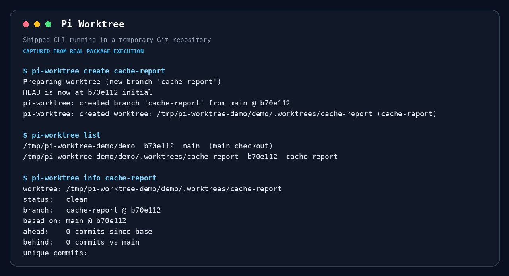
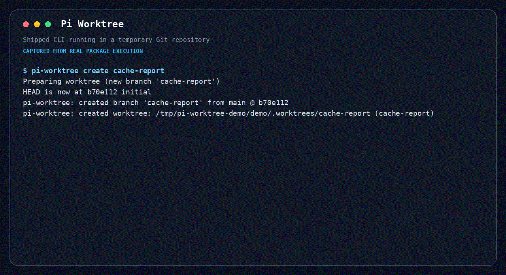

# @maxiaochao/pi-worktree

`pi-worktree` CLI、Pi Extension 与配套 skill。CLI 负责管理 worktree；Extension 让用户或 Agent 在当前 Pi 界面中切换，并保留完整对话。



## 为什么有这个包

这个包把原来分散在主包中的 shell CLI、bash completion、安装逻辑和 agent skill 合成一个发布单元。它让人和 agent 使用同一套隔离流程，避免在主 checkout 中混入并行任务改动。

## 演示



```bash
pi-worktree create feature
pi-worktree create --base main --json feature
pi-worktree info feature
pi-worktree out
pi-worktree remove feature another-feature
```

`create` 可以从主 checkout 或任意 linked worktree 调用。新分支默认基于调用位置的 HEAD，显式 `--base` 优先；新目录统一放在主 checkout 的 `.worktrees/feature`，不嵌套在当前 worktree 中。已有分支只挂载，不重置。未提交改动留在原目录。创建会记录 base，不启动 Pi。`--json` 提供相同操作的机器可读结果。

在交互式 Pi 中，用户可以保留当前界面和完整对话：

```text
/worktree start feature
/worktree start feature --base main
```

命令会把当前持久会话 fork 到目标 worktree，再通过 Pi 的公开 session replacement API 切换。原 session 文件保留；新 session 使用新 ID、复制完整历史，并记录原 session 为 parent。切换后的对话只写入新 session，不同时运行两个 Agent。临时的 `--no-session` 会话无法使用此入口。

Agent 使用 Extension 注册的 `enter_worktree` tool。需要切换时，它创建或复用目标、终止当前工具轮，并在 `agent_settled` 后自动触发内部 `/worktree` 命令。Extension 随后执行 `SessionManager.forkFrom()` 和 `switchSession()`；目标 cwd 会写入新 session header，当前界面继续显示完整对话，重启后也仍然有效。整个流程由 Extension 完成，不需要外部 Harness 适配。若 CLI 返回 `already-active`，包括从当前 worktree 子目录调用，则不终止 Agent、不 fork、不排队切换，直接在当前 session 继续。

## 安装

完整工具包已经包含 CLI、Extension 和 skill：

```bash
pi install npm:@maxiaochao/pi-toolkit
```

只需要 worktree 能力时单独安装：

```bash
pi install npm:@maxiaochao/pi-worktree
```

postinstall 会把 CLI 复制到 `~/.local/bin/pi-worktree`，把 bash completion 安装到 `~/.local/share/bash-completion/completions/pi-worktree`。两种安装方式二选一。

## 更新

```bash
pi update npm:@maxiaochao/pi-toolkit  # 更新主包内置的 CLI 与 skill
pi update npm:@maxiaochao/pi-worktree # 更新独立子包
```

更新会重新运行安装逻辑并覆盖 `~/.local/bin/pi-worktree` 和 completion。主包与子包版本独立，不要同时安装。

## 命令

```bash
pi-worktree create [--base <ref>] [--json] <name>
pi-worktree list
pi-worktree info <name>
pi-worktree out
pi-worktree remove [--force|-f] <name> [<name> ...]
pi-worktree prune
```

`create` 是幂等接口；`create --json` 供 Extension 和其他宿主使用，返回 `created`、`attached`、`reused` 或 `already-active`，以及绝对路径、分支和 dirty 状态。已有 worktree 会复用；已存在但未挂载的同名分支会挂载；stale 注册、非法名称和路径冲突会显式失败。

`info` 与 `remove` 从 Git 登记按完整分支名解析真实路径，支持位于 `.worktrees/` 外的目录和 `fix/dashboard-live-query` 这类分支；这不放宽 `create` 的单段名称限制。两个命令也可从 linked worktree 或子目录调用。补全使用已检出的分支名。

`remove` 按顺序删除指定 worktree；每个脏 worktree 或未合并分支仍需单独确认。合并检查与删除提示都以本地 `main` 为参照；没有 `main` 时必须确认。主 checkout、当前 worktree 和锁定的登记不可删除。失效目录只移除选中的登记，不顺带 prune 其他登记。遇到错误或拒绝确认时停止，已经删除的 worktree 不会恢复。

`remove --force`（或 `-f`）是明确的数据丢弃授权：不读取 stdin、不询问，直接丢弃修改/未跟踪文件，并删除未合入 `main` 的分支。它不会绕过主 checkout、当前 worktree、锁定登记或仓库归属保护；批量操作仍在出错时停止。

```bash
pi-worktree remove --force obsolete-one obsolete-two
```

删除 detached checkout 时也会检查其 HEAD 是否合入 `main`；没有分支或元数据缺失时，不能把提交误认为已合并。

Agent 用法见 `skills/pi-worktree/SKILL.md`。测试流程、夹具和结果见 [TESTING.md](TESTING.md)。

## Already-active paths

`pi-worktree create --json <current-worktree-name>` returns the canonical Git worktree root, even when called from a nested directory. The `already-active` status and whole-worktree `dirty` flag remain unchanged. The extension uses the same CLI result.

Git 2.36+ 使用 NUL 分隔的 `worktree list`；旧版 Git 的文本列表不能转义换行路径，因此只在该选项不受支持时读取 Git 的 worktree 登记文件，避免按文本行猜路径。
