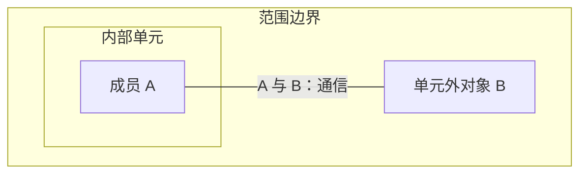

# Mermaid

将图示沉淀到 `docs/` 等 Markdown 文档中。优先更新已有主题文档，保留其他内容；新文档按用户指定位置或项目约定存放。

选最小的视图把关键点讲清；一句话能说清就直接用文字。

- 组成、依赖、条件分支：`flowchart`，包含边界用 `subgraph`。
- 消息先后：`sequenceDiagram`；状态转换：`stateDiagram-v2`；类型：`classDiagram`；实体：`erDiagram`。
- 以包含和并列为主、几乎没有连线、框内成员多（如芯片内部构成）：`text` 围栏的线框，不用 Mermaid。

Mermaid 示例：



文本线框示例：

```text
┌─ 主控侧 ─┐     ┌─ 加速侧 ─┐
│ ┌─────┐  │     │ ┌─────┐  │
│ │ CPU │  │     │ │ NPU │  │
│ └─────┘  │     │ └─────┘  │
└──────────┘     └──────────┘
```

## 语义

- 同名对象属于不同进程、板卡或范围时用不同节点；同一对象在各图中用同一名称。
- 框内只放有依据的成员；包含不等于启动或通信，功能域不等于物理装配。
- 连线写明启动、调用、通信或物理接口；关系须有依据，未知项在图外说明，不为排版添加虚构关系或隐藏边。

## 布局与显示

- 使用项目已有的 Mermaid 预览器或 CLI 验证语法与布局；通过标准是文字完整、无裁切或标签遮挡。
- 对 `flowchart` 比较 `TB` 与 `LR` 的宽高，选择适合文档版面的方向；标题短，需要时用 `<br/>` 分行。
- 嵌套框内无连线的节点会叠成一行或一列，`direction` 在子图有外部连线时不生效；整图过长时按主题拆图，每张图关系各自完整。
- 线框按显示宽度对齐（东亚宽字符算 2 列），用脚本检查各行宽度及对应边框的列位置；内部框完整落在所属外框内。
- 交付时说明使用的验证工具和结果；只报告做过的验证，未验证的部分明确说明。
